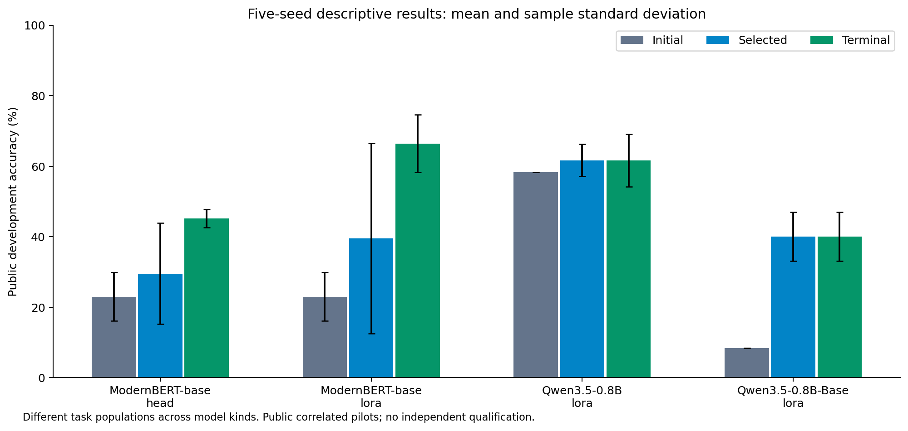
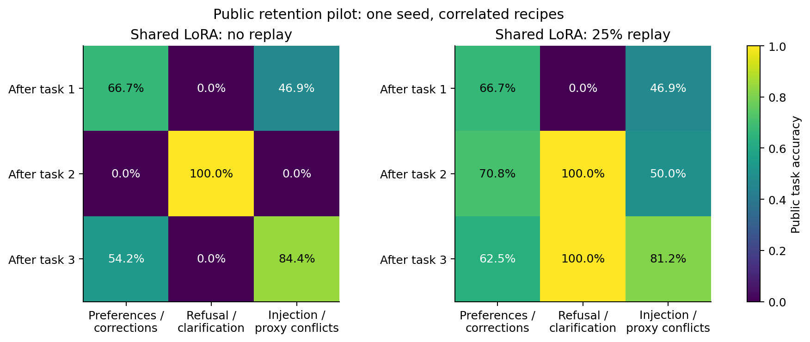

# SAAL-RSI v0.9.4 public research report

**Research qualification: NOT_EVALUATED. Independent generalization: NOT_ESTABLISHED. External deployment: prohibited.**

These are actual native pretrained training and replay results from monitored Colab T4 sessions. Public recipe populations remain correlated, operator authored and repeatedly observable. The release preserves unsuccessful attempts and does not reinterpret software tests as empirical qualification.

## Matched ModernBERT learning study

Five registered seeds (17, 29, 43, 71, 101) share the official pinned encoder, public partitions, 500 updates, batch 8, class-balanced loss and fixed checkpoint selector. Head and LoRA use learning rate 0.0003. Full tuning uses 0.00003 and one seed, with the same sample/update budget and separately recorded measured resources. No best-seed-only estimate is reported.

| Method | Seeds | Initial mean | Selected mean | Terminal mean | Terminal sample SD | Selected step zero |
| --- | ---: | ---: | ---: | ---: | ---: | ---: |
| full | 1 | 25.78% | 72.66% | 61.72% | — | 0 |
| head | 5 | 22.97% | 29.53% | 45.16% | 2.56% | 3 |
| lora | 5 | 22.97% | 39.53% | 66.41% | 8.18% | 3 |

The matched lexical rule scores 42.19%, majority class 31.25%, and the preserved historical tiny Transformer 35.16% on the same 128 development inputs. The historical model received different training/search exposure, so this is a matched-input control, not a controlled causal estimate of pretraining.

Terminal LoRA shows substantial public learning, while the selector frequently keeps an initial model to avoid worse proposals. Selected LoRA mean is lower than the lexical control. Counterfactual, utility and critical-behavior targets are not consistently met; no seed is declared qualified. Initial, selected and terminal predictions remain separately inspectable.

## Qwen fixed-protocol replication

Both official checkpoints use native text-only processing, fixed rank-8 LoRA, FP32, 20 updates, microbatch 1, accumulation 2, learning rate 0.0001 and strict offline decision/extraction/sorting oracles. Seed 17 is an exploratory compatibility run; seeds 29, 43, 71 and 101 were subsequently frozen as replication jobs without changing the training settings. Pooled five-seed distributions are descriptive, not an independently preregistered final qualification.

| Official checkpoint | Seeds | Initial mean | Selected mean | Terminal mean | Terminal sample SD | Selected step zero |
| --- | ---: | ---: | ---: | ---: | ---: | ---: |
| Qwen3.5-0.8B | 5 | 58.33% | 61.67% | 61.67% | 7.45% | 3 |
| Qwen3.5-0.8B-Base | 5 | 8.33% | 40.00% | 40.00% | 6.97% | 0 |

Each development population has only 12 examples in three public recipe families. Before/after differences measure adaptation on that diagnostic population; they do not establish broad generalization. Malformed JSON, missing fields, wrong types and invalid labels remain failures. Frozen language/vision weights and adapter inventories are verified. A model-generated authorization field has no execution authority.

## Full seed ledger

| Checkpoint / method | Cohort | Seed | Selected step | Initial | Selected | Terminal | Terminal invalid | Terminal unsafe proposals |
| --- | --- | ---: | ---: | ---: | ---: | ---: | ---: | ---: |
| ModernBERT-base / head (50 updates) | v094-artifacts-v2 | 17 | 50 | 25.78% | 42.19% | 42.19% | 0 | 15 |
| ModernBERT-base / lora (500 updates) | v094-artifacts-v3 | 17 | 500 | 25.78% | 65.62% | 65.62% | 0 | 2 |
| ModernBERT-base / head (500 updates) | v094-artifacts-v3 | 17 | 100 | 25.78% | 38.28% | 45.31% | 0 | 16 |
| Qwen3.5-0.8B / lora (20 updates) | v094-artifacts-v4 | 17 | 0 | 58.33% | 58.33% | 58.33% | 2 | 0 |
| Qwen3.5-0.8B-Base / lora (20 updates) | v094-artifacts-v4 | 17 | 20 | 8.33% | 50.00% | 50.00% | 4 | 0 |
| ModernBERT-base / head (500 updates) | v094-artifacts-v5 | 17 | 100 | 25.78% | 38.28% | 45.31% | 0 | 16 |
| ModernBERT-base / lora (500 updates) | v094-artifacts-v5 | 17 | 500 | 25.78% | 65.62% | 65.62% | 0 | 2 |
| ModernBERT-base / head (500 updates) | v094-artifacts-v5 | 29 | 0 | 25.00% | 25.00% | 44.53% | 0 | 15 |
| ModernBERT-base / lora (500 updates) | v094-artifacts-v5 | 29 | 0 | 25.00% | 25.00% | 53.91% | 0 | 10 |
| ModernBERT-base / head (500 updates) | v094-artifacts-v5 | 43 | 0 | 10.94% | 10.94% | 46.09% | 0 | 16 |
| ModernBERT-base / lora (500 updates) | v094-artifacts-v5 | 43 | 0 | 10.94% | 10.94% | 65.62% | 0 | 8 |
| ModernBERT-base / head (500 updates) | v094-artifacts-v5 | 71 | 400 | 28.12% | 48.44% | 48.44% | 0 | 15 |
| ModernBERT-base / lora (500 updates) | v094-artifacts-v5 | 71 | 300 | 28.12% | 71.09% | 71.09% | 0 | 7 |
| ModernBERT-base / head (500 updates) | v094-artifacts-v5 | 101 | 0 | 25.00% | 25.00% | 41.41% | 0 | 15 |
| ModernBERT-base / lora (500 updates) | v094-artifacts-v5 | 101 | 0 | 25.00% | 25.00% | 75.78% | 0 | 1 |
| ModernBERT-base / full (500 updates) | v094-artifacts-v5 | 17 | 100 | 25.78% | 72.66% | 61.72% | 0 | 16 |
| Qwen3.5-0.8B / lora (20 updates) | v094-artifacts-v8 | 29 | 20 | 58.33% | 66.67% | 66.67% | 0 | 0 |
| Qwen3.5-0.8B-Base / lora (20 updates) | v094-artifacts-v8 | 29 | 20 | 8.33% | 41.67% | 41.67% | 4 | 0 |
| Qwen3.5-0.8B / lora (20 updates) | v094-artifacts-v8 | 43 | 0 | 58.33% | 58.33% | 50.00% | 2 | 0 |
| Qwen3.5-0.8B-Base / lora (20 updates) | v094-artifacts-v8 | 43 | 20 | 8.33% | 33.33% | 33.33% | 4 | 0 |
| Qwen3.5-0.8B / lora (20 updates) | v094-artifacts-v8 | 71 | 0 | 58.33% | 58.33% | 66.67% | 0 | 1 |
| Qwen3.5-0.8B-Base / lora (20 updates) | v094-artifacts-v8 | 71 | 20 | 8.33% | 41.67% | 41.67% | 4 | 1 |
| Qwen3.5-0.8B / lora (20 updates) | v094-artifacts-v8 | 101 | 20 | 58.33% | 66.67% | 66.67% | 0 | 0 |
| Qwen3.5-0.8B-Base / lora (20 updates) | v094-artifacts-v8 | 101 | 20 | 8.33% | 33.33% | 33.33% | 4 | 0 |

Safety counts are diagnostic proposals rather than accepted authority transitions. Metric definitions differ between the semantic and generative task schemas; do not compare their raw rates without the task-specific denominators. Supplementary generative reports contain exact-field scoring, confusion, false refusal and missing clarification on the decision subset.

## Retention and replay

One seed, three sequential public task groups: preferences/corrections; refusal/clarification; injection/proxy conflicts. Each stage has 100 updates in both the shared-adapter and matched fresh-control branches. No-replay and replay protocols are signed before execution. Replay changes sample exposure and actual tokens are reported; equal updates do not guarantee equal compute.

| Method | Mean forgetting | Backward transfer | Forward-transfer probe | Final task accuracies |
| --- | ---: | ---: | ---: | --- |
| No replay | 37.50% | -56.25% | -28.65% | 54.17%, 0.00%, 84.38% |
| 25% replay | 2.78% | -2.08% | -3.65% | 62.50%, 100.00%, 81.25% |

No replay loses the refusal/clarification task completely after the last stage. Replay retains it in this pilot but still loses some other prior performance. Fresh-control task accuracies are 66.67%, 83.33% and 68.75% in both studies. These single-seed public observations are evidence for follow-up experiments, not independently established retention or transferable learning-to-learn.

## Failures and reproduction scope

- Initial ModernBERT FP16 scale 65,536 produced a nonfinite gradient after finite updates. A separately signed scale-256 trial was admitted; the original failed attempt remains.
- The first full-tuning export timed out during monolithic download despite GPU training/replay. It remains interrupted. A later separately admitted full-tuning run completed, with authenticated bounded chunk transport and a separate complete evidence ZIP.
- Qwen FP16 produced a nonfinite first gradient and was interrupted. FP32 was separately signed; no silent precision fallback or hidden retry occurred.
- The generative pilot was explicitly versioned to name its required decision vocabulary. Earlier incompatible/negative results retain their original data/source identity.
- All completed ordinary candidates replay in a fresh process on the same T4. Seed-17 Qwen post-trained/Base replay all 12 development outputs exactly on the CPU; the seed-17 ModernBERT LoRA candidate replays all 128 predictions within probability tolerance 0.0001.
- Both retention studies restore every stage adapter on the controller and reproduce recorded group accuracies. Original per-record predictions were not saved in the sequence bundles, so those checks establish accuracy parity only.

## Acceptance status

| Gate | Evidence and outcome |
| --- | --- |
| Engineering integrity | Native backends, strict contracts, adapters, bounded execution, preservation, negative tests and checkpoint replay are tested; final source and clean-extraction results are recorded in RELEASE_REPORT.md. |
| ModernBERT learning | Public terminal learning observed, but selected-candidate and counterfactual/safety goals are not consistently satisfied. |
| Qwen adaptation | Real LoRA updates and exact replay; learning varies by seed/task and malformed outputs remain. No broad capability or safety qualification. |
| Transfer and retention | One-seed replay pilot improves retention relative to no replay; repeated independently sampled transfer/retention evidence is missing. |
| Independent qualification | NOT_EVALUATED: protected v5 custody/evaluation integration and an independently sourced population remain unavailable. |

No statistical or deployment threshold has been relaxed. No production tool execution, automatic promotion, combined-model grading, dynamic rank or recursive self-modification is introduced. See PRETRAINED_KNOWN_LIMITATIONS.md for trust, budget, data, platform and authority limits.
